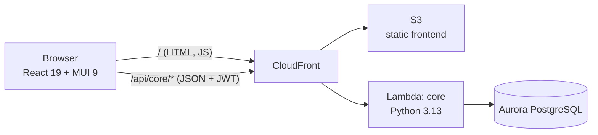
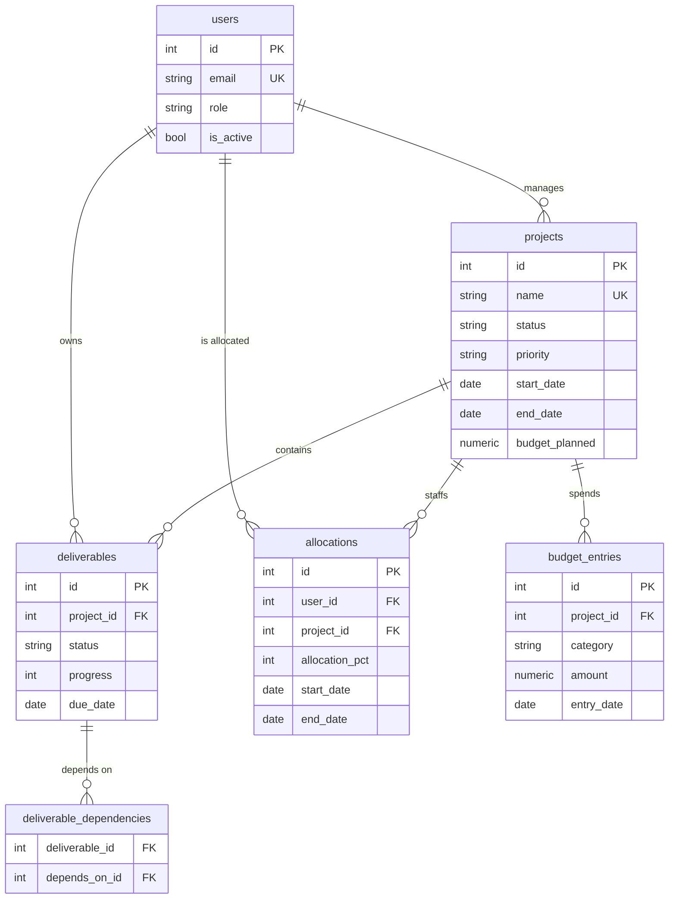

# ACME Projects — Project Management & Tracking Platform

A self-service web application that gives ACME Inc. real-time visibility into project
health, resource utilisation, deliverable progress and budget consumption.

- **Live (AWS):** https://d5kq129n4c42b.cloudfront.net
- **Demo accounts** (password `Password123`): `admin@acme.com`, `manager@acme.com`,
  `contributor@acme.com`, `viewer@acme.com`

> Built for the coding workshop. The original workshop guides are in [docs/](./docs/README.md).

## Contents

- [Business questions answered](#business-questions-answered)
- [Architecture](#architecture)
- [Data model](#data-model)
- [Roles and permissions](#roles-and-permissions)
- [Getting started (local)](#getting-started-local)
- [Deploying to AWS](#deploying-to-aws)
- [Testing](#testing)
- [Design decisions and trade-offs](#design-decisions-and-trade-offs)
- [Assumptions](#assumptions)
- [Known gaps and next steps](#known-gaps-and-next-steps)

## Business questions answered

| Question | Where | How it is computed |
| -------- | ----- | ------------------ |
| Current status of each active project | Dashboard → *Project status*; Projects list | Stored `status` plus derived progress (average deliverable progress) and schedule elapsed % |
| Which projects are at risk of missing deadlines | Dashboard → *Projects needing attention*; Projects `?risk=` filter | `off_track`: past end date or over budget. `at_risk`: overdue or blocked deliverables, or progress trailing elapsed schedule by > 20 points. Each project lists its reasons |
| How resources are allocated across projects | Resources → *Utilisation*; project *Team* tab | Sum of `allocation_pct` per person for allocations active on a chosen date |
| Key deliverables and completion status | Deliverables; project *Deliverables* tab; Dashboard → *Upcoming & overdue* | Status, progress, due date, overdue flag |
| Which team members are over-allocated | Dashboard tile; Resources alert | Concurrent allocations totalling > 100% |
| Dependency chain between deliverables | Deliverable detail; Dashboard → *Blocked by dependencies* | Recursive SQL over `deliverable_dependencies` (upstream and downstream); cycles rejected |
| Budget consumed vs planned | Budget page; Dashboard → *Budget*; project summary | Sum of spend entries vs `budget_planned`, with % used and remaining |

## Architecture



Locally the same code runs on LocalStack (Lambda), a local PostgreSQL, a Vite dev
server on `:3000`, and a CORS proxy on `:3001` (`bin/proxy-server.js`).

| Layer | Location | Notes |
| ----- | -------- | ----- |
| Frontend | [frontend/](./frontend/README.md) | Pages, shared components, hooks, API client |
| API | [backend/core/](./backend/core/README.md) | One Lambda, code organised by feature; full endpoint reference in its README |
| Tests | [backend/tests/](./backend/tests), `frontend/src/**/*.test.*`, [frontend/e2e/](./frontend/e2e) | Unit, integration, component, end-to-end, load |
| Infrastructure | [infra/](./infra/README.md) | Terraform (provided by the workshop; one change, see below) |
| Scripts | [bin/](./bin/README.md) | Setup, local dev, deploy |

## Data model



Integrity is enforced in the database too (check constraints for enums, ranges and
date order; foreign keys with `CASCADE`/`SET NULL`). The schema is created automatically
on the first request, and demo data is seeded when the database is empty.

## Roles and permissions

| Role | Read | Create / update | Delete | Manage users |
| ---- | :--: | :-------------: | :----: | :----------: |
| Admin | ✓ | ✓ | ✓ | ✓ |
| Manager | ✓ | ✓ | ✓ | |
| Contributor | ✓ | ✓ | | |
| Viewer | ✓ | | | |

Enforced centrally in the API router; the UI hides actions the role cannot use.
Admins cannot demote, deactivate or delete themselves. Role changes and deactivation
take effect on the next request, because the role is read from the database rather than
trusted from the token.

## Getting started (local)

Prerequisites are installed by `./bin/setup-environment.sh` (see [docs/validation.md](./docs/validation.md)).

```sh
# 1. Python dependencies for LocalStack hot-reload (one time, or after changing requirements.txt)
pip install -r backend/core/requirements.txt -t backend/core/.vendor \
    --platform manylinux2014_x86_64 --python-version 3.13 --only-binary=:all: --upgrade

# 2. Deploy the API to LocalStack
./bin/deploy-backend.sh local

# 3. Start proxy + frontend (restart this after any backend deploy)
./bin/start-dev.sh
```

Open http://localhost:3000 and use a demo account button on the login page.
Backend code changes are hot-reloaded; frontend changes reload instantly.

## Deploying to AWS

```sh
./bin/deploy-backend.sh     # Terraform: Lambda, Aurora, S3, CloudFront (refreshes credentials)
./bin/deploy-frontend.sh    # build, upload to S3, invalidate CloudFront
```

The deploy scripts refresh the short-lived participant credentials automatically.

## Testing

| Suite | Command | Result |
| ----- | ------- | ------ |
| Backend unit + integration (pytest, real PostgreSQL) | `cd backend && python -m pytest tests --cov=core/app` | **60 passed, 95% coverage** |
| Frontend unit + component (Vitest, React Testing Library) | `cd frontend && npm run test:coverage` | **53 passed, 87.6% statements / 91% lines** |
| End-to-end (Playwright, Chromium, desktop + Pixel 7) | `cd frontend && E2E_BASE_URL=<url> npm run e2e` | **7 passed** against AWS |
| Load (stdlib script) | `python backend/tests/load_test.py --base <url>/api/core --concurrency 10 --requests 300` | **0 errors, 162 req/s, p50 40 ms, p95 78 ms** (AWS) |
| Lint | `cd frontend && npm run lint` | clean |

One-time setup for backend tests:

```sh
python3 -m venv backend/core/.venv
backend/core/.venv/bin/pip install -r backend/core/requirements.txt pytest pytest-cov
PGPASSWORD=postgres123 psql -h localhost -U postgres -c "CREATE DATABASE pm_test"
```

For end-to-end tests, install the browser once with `npx playwright install chromium`.

**What is covered**

- **Backend:** business rules (risk, schedule, budget, over-allocation), validation,
  password and token helpers, every endpoint's contract (status codes, error shape,
  filters), RBAC per role, privilege-escalation guards, dependency cycles, the
  "cannot complete with open dependencies" rule, cascading deletes, and masking of
  internal errors.
- **Frontend:** API client (token refresh, network errors, non-JSON responses), form
  validation and server error mapping, each page's rendering, role-based visibility,
  create/edit/delete flows, filters, error and empty states, routing guards, and the
  mobile and desktop layouts.
- **End-to-end:** login failure and success, sign-out, dashboard, viewer read-only access,
  admin user management, full project lifecycle (create → deliverables with dependency →
  dependency rule → chain view → overspend turns the project off track → delete),
  client-side validation, and the mobile layout. Tests create uniquely named data and
  clean it up afterwards.

**Known test gaps:** no tests for concurrent edits; the end-to-end suite runs on
Chromium only; the load test is a short burst rather than a sustained soak.

## Design decisions and trade-offs

| Decision | Why | Trade-off |
| -------- | --- | --------- |
| **One Lambda for the whole API**, split into modules per feature | Resources share one schema, one auth model and many cross-resource queries; avoids duplicating code or adding a shared layer | All endpoints scale and deploy together |
| **Plain SQL with psycopg 3** (no ORM) | Aggregations (health, utilisation, recursive dependency chains) are clearest in SQL; small cold-start footprint | More hand-written SQL; all values are parameterised and identifiers quoted with `psycopg.sql` |
| **Derived metrics computed on read** (risk, progress, spend) | Always consistent, nothing to keep in sync | Heavier list queries; fine at this scale (p95 < 100 ms) |
| **Risk rules as pure functions** (`app/metrics.py`) | Easy to unit-test and explain; reasons are shown to users | Thresholds (20 points, 100%) are constants, not configurable per project |
| **JWT with a database-backed role check** | Stateless tokens, but deactivation and role changes apply immediately | One extra primary-key lookup per request |
| **PBKDF2 (stdlib) for passwords** | No native dependency to build for Lambda | Slower than bcrypt/argon2 for the same strength at 128 MB; 150k iterations |
| **JWT secret generated and stored in the database** | No infrastructure change or secret wiring needed | Anyone with database access could read it; `JWT_SECRET` env var overrides it |
| **Schema and seed data on cold start** | Zero-step deploys for the workshop | Not a migration system; schema changes after go-live would need migrations |
| **HashRouter** (`/#/projects`) | Works on S3/CloudFront without rewrite rules | Less clean URLs |
| **Removed CloudFront's 404 → index.html fallback** (`infra/cloudfront.tf`) | It applied to API responses too, turning API 404s into HTML with status 200 | The SPA relies on hash routing instead |
| **Vendored deps in `backend/core/.vendor`** for local runs | LocalStack hot-reload mounts the source folder without installing requirements | One extra local setup command (ignored by git and excluded from the cloud package) |
| **Local proxy forwards `Authorization`** (`bin/proxy-server.js`) | The provided proxy dropped it, so authenticated calls failed locally | — |

## Assumptions

- A person's capacity is 100%; over-allocation means allocations active on the same date add up to more than 100%.
- Project progress is the average progress of its deliverables (unweighted).
- Budget amounts are a single currency (USD); spend is recorded as entries against a project.
- Dependencies may cross projects; a deliverable cannot be marked complete until all its dependencies are complete.
- Contributors may create and update any record but not delete. Project-level ownership (for example "managers edit only their own projects") is not enforced.
- Demo data is acceptable in the workshop environment (`SEED_DEMO_DATA=false` disables it).

## Known gaps and next steps

- **Security hardening:** rate-limit login, rotate the JWT secret, change the demo
  passwords, and move tokens from `localStorage` to httpOnly cookies.
- **Ownership rules:** restrict managers to their own projects if the business wants that.
- **Pagination:** list endpoints return all rows; add `limit`/`offset` once data grows.
- **Migrations:** replace create-on-start DDL with versioned migrations (for example Alembic).
- **History:** audit log and trend charts (progress and spend over time).
- **Cold starts:** the first request after idle takes a few seconds (VPC Lambda + database
  connection); provisioned concurrency would remove it.

## License

MIT-0. See [LICENSE](./LICENSE). Workshop materials © their respective authors; see
[CONTRIBUTING](./CONTRIBUTING.md).
